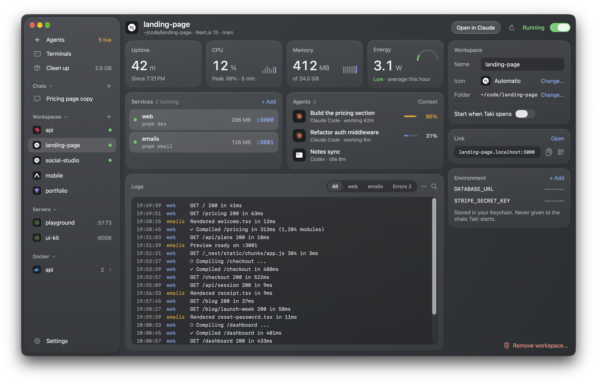
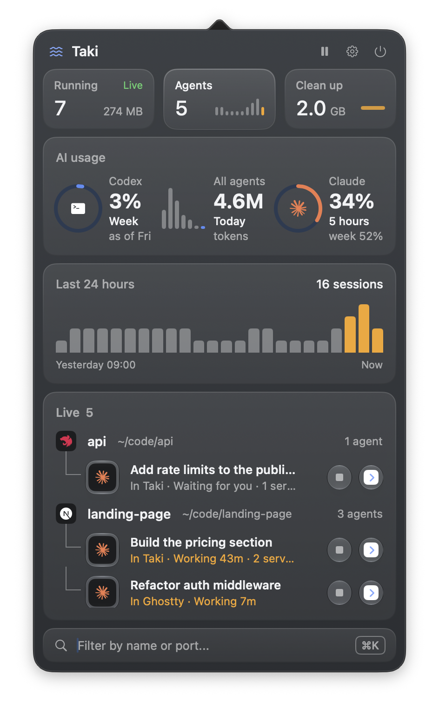
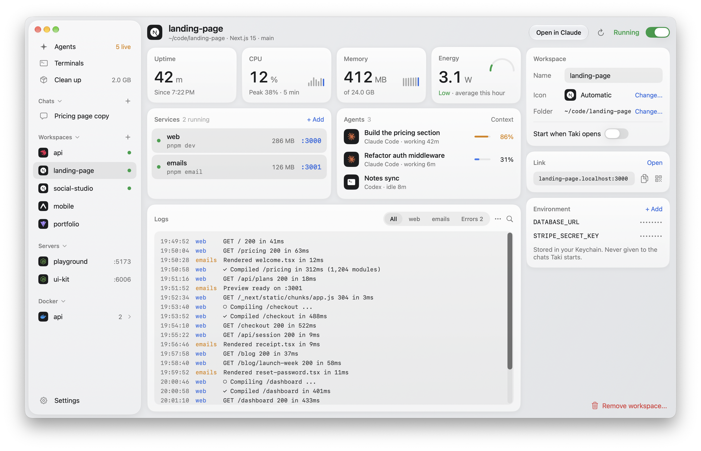
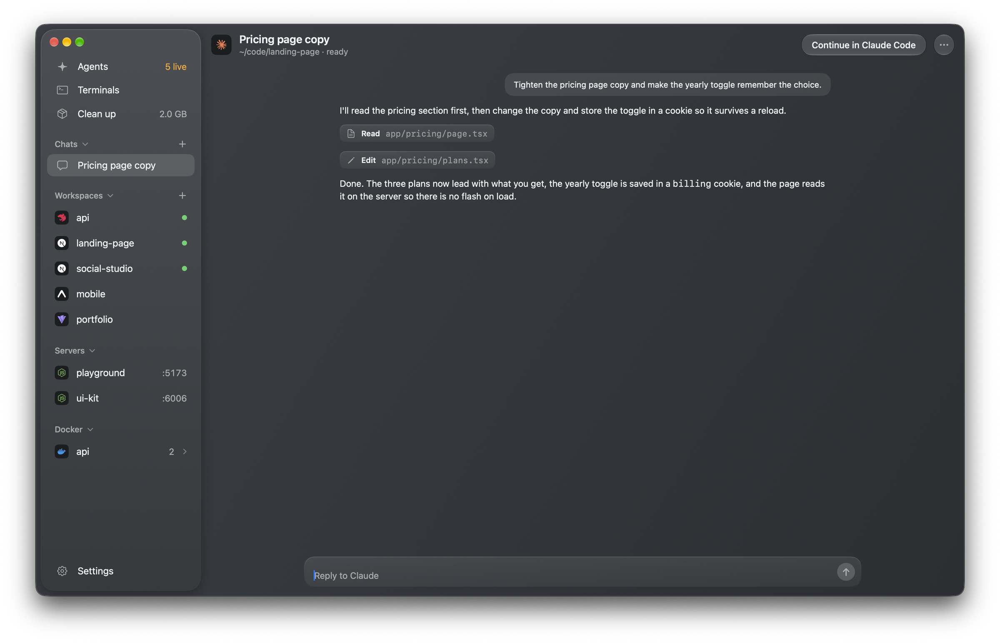

Taki is a native Mac app for people who run several coding agents and dev servers at once. It finds every Claude Code, Codex and Cursor session on the Mac, wherever it was started, puts each one next to the project it is working on with that project's servers, logs and containers, and lets you jump to it, continue it or stop it. You can also chat with Claude Code and open terminal tabs inside the app, so a day of agent work stays in one window instead of a dozen Terminal windows.

Taki is Japanese for waterfall: many streams falling into one place.

## What it does

**Agents, wherever they run**
- Finds every live Claude Code, Codex and Cursor session, whichever app it runs in (Terminal, iTerm, Ghostty, an editor or Taki itself), and shows what each is doing: working, idle or waiting for you, and for how long.
- Shows how much of each Claude session's context window is used, so you know when to compact or start fresh.
- **Open** goes to the agent: its chat, its Taki tab, or the exact Terminal or iTerm tab it runs in. In other apps it brings that app forward.
- **Continue in Claude Code** resumes the same conversation in a new tab. **Stop** ends it like Ctrl-C.
- Claude plan limits (the 5-hour and weekly windows, with reset times), tokens today and this week, and sessions over the last 24 hours.

**Workspaces, found by themselves**
- Any project with an agent, a dev server or a Docker compose stack running in it becomes a workspace on its own. Found ones drop off a day after nothing runs there; change one and it stays. A package inside a monorepo keeps its own agents and servers.
- The badge is the project's own framework (Next.js, NestJS, Vite, Expo, Astro, Flutter, Django, Go, Rust and more), read from its files.
- Start and stop the project's services, with environment variables kept in your Keychain and never given to the chats Taki starts. Logs are coloured by service, with filters, search and an error count.
- Uptime, CPU with a five-minute peak, memory and energy for the whole workspace.
- Every workspace gets a short link, `name.localhost`, with no port to remember. The proxy listens on this Mac only. A QR code opens the project on your phone over the same Wi-Fi.
- Docker containers are grouped by compose project, with their health and ports. Servers that belong to no workspace are listed on their own.

**Claude Code in the app**
- Chat with Claude Code in any folder, through Claude Code itself. Your settings, hooks, skills and `CLAUDE.md` all apply. Permission prompts appear as cards you answer with Allow (Cmd-Return) or Deny.
- Chats come back after a relaunch and resume the same session. An idle chat gives its process back after ten minutes and picks up where it left off on the next message.

**Terminals in the app**
- Shell, Claude Code and Codex tabs in one switcher that stays usable with fifteen tabs open: grouped by project, filter as you type, Cmd-1 to Cmd-9, Cmd-Shift-[ and ].
- A tab follows its shell's folder. Closing or quitting asks first when something is still running.
- After a relaunch each Claude tab resumes its own conversation.

**The menu bar**
- What is running, how many agents are live, and what Clean up would free, at a glance.
- Codex and Claude usage rings, the last 24 hours, and a live tree of every agent by project, with Stop and Open on each.
- Filter by name or port with Cmd-K. Option-Space opens a command palette from any app.

**Clean up**
- Agent worktrees whose branch is merged, build caches in idle projects, transcripts older than 30 days and processes left behind by agents that ended. Everything goes to the Trash, so nothing is lost by mistake. A worktree with uncommitted work, or with an agent still inside it, is never offered.

**And**
- Five desktop widgets: servers, agents, workspaces, AI usage and Claude limits.
- A notification when a server has been left running for two hours, and when a Claude limit is nearly used.
- Light and dark appearance, following the Mac or set by hand.

<table>
<tr>
<td width="68%"></td>
<td width="32%"></td>
</tr>
</table>

## Privacy

Taki has no account, no analytics and no server of its own. Everything it shows is read on your Mac: running processes, the session files Claude Code and Codex already keep in your home folder, `lsof` for listening ports and `docker ps` for containers. The only network traffic is what Claude Code itself sends when you chat, and one tiny Haiku request when you press Refresh on Claude limits. Workspace secrets live in the Keychain. Taki's own files are written readable by your user only.

## Install

Taki isn't notarised yet, so build it yourself:

1. Requirements: macOS 26 or later, Xcode 26 or later (CI builds with Xcode 27), and [XcodeGen](https://github.com/yonaskolb/XcodeGen) (`brew install xcodegen`). Chat and Claude tabs need [Claude Code](https://docs.anthropic.com/en/docs/claude-code) on your PATH.
2. At the top of `project.yml`, set `DEVELOPMENT_TEAM` to your team ID and `TAKI_BUNDLE_PREFIX` to your own reverse-DNS prefix. The bundle IDs, the entitlements and the app group the widget shares are all built from those two lines.
3. Run `./scripts/build.sh`. It builds a Release copy, installs it to `/Applications/Taki.app` and opens it.

Tests: `./scripts/test.sh`. The host app skips its own startup under XCTest, so tests never touch your agents, servers or files.

The screenshots above use Taki's built-in sample data: launch `/Applications/Taki.app/Contents/MacOS/Taki -TakiDemo`. Demo mode reads nothing from the Mac, starts nothing, and keeps its files in a temporary folder, away from Taki's real ones.

## How it works

| Part | Where |
|---|---|
| Live agents: Claude Code session files, `ps` for Codex and Cursor, libproc for each process's folder, parent and memory | `Taki/Core/AgentScanner.swift`, `ProcessScanner.swift` |
| Usage: transcripts read incrementally (each file from where the last read stopped), every message counted once | `Taki/Core/UsageScanner.swift` |
| Chat: `claude -p` with stream-json in and out, permission prompts over the control protocol | `Taki/Core/ChatSession.swift`, `ClaudeStream.swift` |
| Services: login-shell environment, Keychain variables, process trees ended as a whole | `Taki/Core/ServiceRunner.swift`, `ShellEnvironment.swift` |
| Short links: a loopback-only HTTP proxy on port 80 | `Taki/Core/LocalProxy.swift` |
| Terminals: [SwiftTerm](https://github.com/migueldeicaza/SwiftTerm) | `Taki/UI/TerminalRegistry.swift`, `TerminalsView.swift` |
| Clean up, with every item checked again just before it moves | `Taki/Core/Cleanup.swift` |

Built with Swift 6 and SwiftUI. Framework marks are from [Simple Icons](https://simpleicons.org) (CC0). The brand files and how to regenerate them are in [`brand/`](brand/BRAND.md).

## License

MIT. See [LICENSE](LICENSE).
