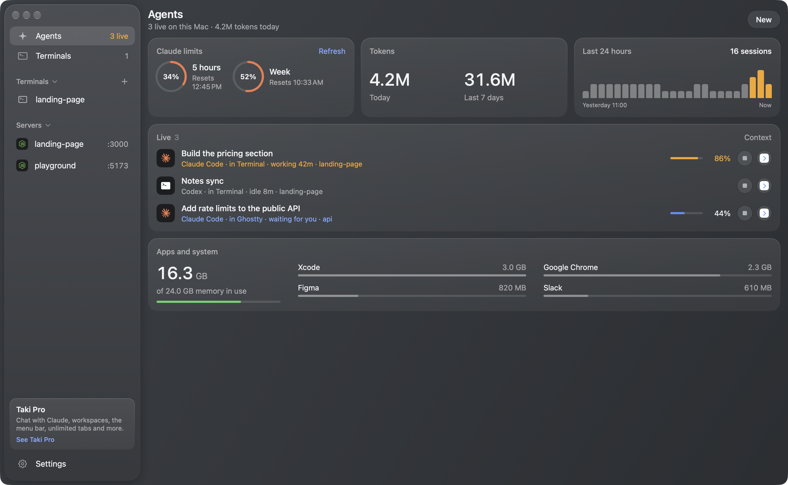

Taki is a native Mac app for people who run several coding agents at once. It finds every Claude Code, Codex and Cursor session on the Mac, wherever it was started, shows what each one is doing and how full its context is, and lets you jump to it or stop it. Your Claude plan limits, token use and dev servers sit on the same screen, and two terminal tabs live right inside the app.

Taki is Japanese for waterfall: many streams falling into one place.

## What it does

- Finds every live Claude Code, Codex and Cursor session, in whichever app it runs (Terminal, iTerm, Ghostty, an editor), and shows whether it is working, idle or waiting for you, and for how long.
- Shows how much of each Claude session's context window is used, so you know when to compact or start fresh.
- **Open** goes to the agent: its Taki tab, or the exact Terminal or iTerm tab it runs in. **Stop** ends it like Ctrl-C.
- Claude plan limits (the 5-hour and weekly windows, with reset times), tokens today and this week, and sessions over the last 24 hours.
- Every dev server listening on the Mac, with its port. Click one to open it.
- Two terminal tabs inside the app: a shell, Claude Code or Codex. A tab follows its shell's folder and comes back after a relaunch.
- The apps using the Mac's memory, and light and dark appearance.

## Taki Pro

Taki Pro is the full app, for people who live in their agents all day. It adds chat with Claude Code inside the app, workspaces that start and stop your services with Keychain variables and live logs, port-free `name.localhost` links, Docker, unlimited terminal tabs, the menu bar panel and command palette, Clean up, warnings when two agents edit the same file, alerts and desktop widgets. See [icowebagency.com/taki](https://icowebagency.com/taki).

## Privacy

Taki has no account, no analytics and no server of its own. Everything it shows is read on your Mac: running processes, the session files Claude Code and Codex already keep in your home folder, and `lsof` for listening ports. The only network traffic is one tiny Haiku request through Claude Code when you press Refresh on Claude limits.

## Build it

1. Requirements: macOS 26 or later, Xcode 26 or later (CI builds with Xcode 27), and [XcodeGen](https://github.com/yonaskolb/XcodeGen) (`brew install xcodegen`). Claude tabs need [Claude Code](https://docs.anthropic.com/en/docs/claude-code) on your PATH.
2. At the top of `project.yml`, set `DEVELOPMENT_TEAM` to your team ID and `TAKI_BUNDLE_PREFIX` to your own reverse-DNS prefix.
3. Run `./scripts/build.sh`. It builds a Release copy, installs it to `/Applications/Taki.app` and opens it.

Tests: `./scripts/test.sh`. The screenshots use Taki's built-in sample data: launch `/Applications/Taki.app/Contents/MacOS/Taki -TakiDemo`. Demo mode reads nothing from the Mac and starts nothing.

## How it works

| Part | Where |
|---|---|
| Live agents: Claude Code session files, `ps` for Codex and Cursor, libproc for each process's folder, parent and memory | `Taki/Core/AgentScanner.swift`, `ProcessScanner.swift` |
| Usage: transcripts read incrementally, every message counted once | `Taki/Core/UsageScanner.swift` |
| Claude limits: the rate limit events in Claude Code's stream-json output | `Taki/Core/ClaudeStream.swift` |
| Terminals: [SwiftTerm](https://github.com/migueldeicaza/SwiftTerm) | `Taki/UI/TerminalRegistry.swift`, `TerminalsView.swift` |

Built with Swift 6 and SwiftUI. Framework marks are from [Simple Icons](https://simpleicons.org) (CC0). The brand files are in [`brand/`](brand/BRAND.md).

## License

MIT. See [LICENSE](LICENSE).
